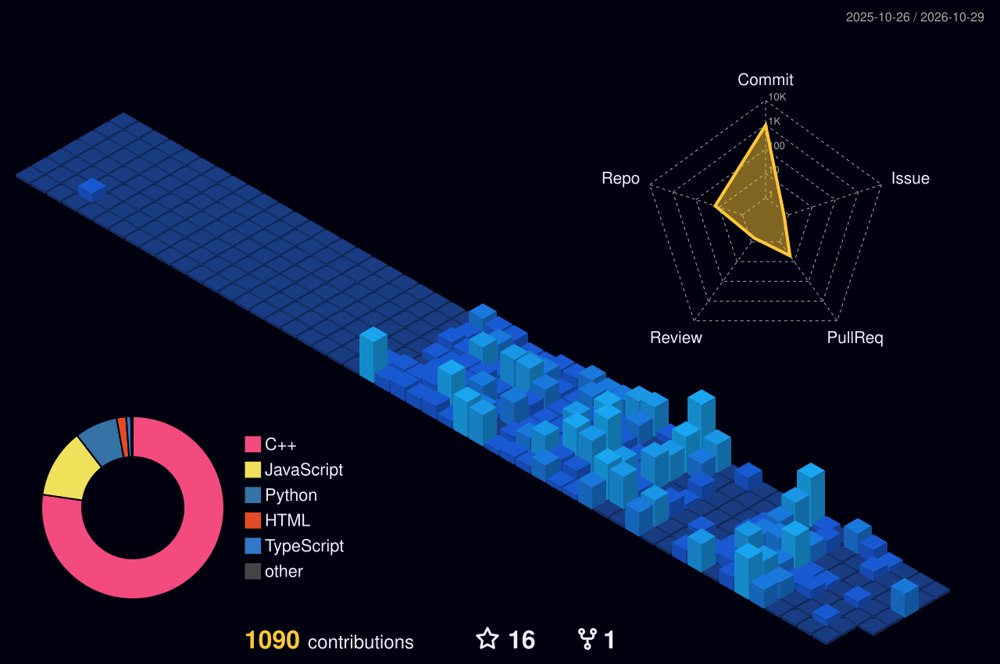

<div align="center">


<br>

# 🌿 Reflections

> *"In the end, the greatest victory is not over kingdoms, but over oneself. When the battles are over and ambition grows quiet, all that remains is the peace to admire a sky that never asked who won."*

<br>

> *"Every battle eventually ends. Every title is forgotten. Every sword grows dull. Yet the wind still moves through the fields, and the trees continue to stand. Perhaps peace was the destination all along."*

<br>

> *"When the noise of ambition fades, nature reminds us what was always enough."*

<br>

> *"We spend our lives preparing for war against the world, only to discover that the greatest reward was the silence we ignored along the way."*

<br>

> *"Strength is forged in conflict, but wisdom is found in stillness. I hope that after every challenge I face, I never lose the ability to sit quietly and admire the world that existed long before me."*

</div>

---

# 👨‍💻 About Me

I'm **Zeeshan**, a Computer Science Engineering student passionate about building systems that combine **Artificial Intelligence**, **Cybersecurity**, and **Software Engineering**.

Currently, I'm dedicating most of my time to **Data Structures & Algorithms**, strengthening my backend fundamentals, and building projects that turn concepts into practical experience.

I believe consistency outweighs intensity. Every project, every solved problem, and every line of code is another step toward mastery.

---

# 🚀 Tech Stack

<div align="center">


<br><br>


</div>

# 📊 GitHub Stats

<div align="center">


<br><br>


</div>

# 📌 Featured Projects

<div align="center">

<a href="https://github.com/AlexZeeshan-10/DSA">

</a>

<a href="https://github.com/AlexZeeshan-10/Development">

</a>

</div>

# 🏆 Competitive Programming

<div align="center">

<a href="https://leetcode.com/u/alexzeeshan_10/">


</a>

</div>

# ⌛ Weekly Coding Activity

<!--START_SECTION:waka-->

```txt
Total Time: 50 mins

C++          45 mins               ██████████████████████▓░░   91.17 %
JavaScript   3 mins                █▓░░░░░░░░░░░░░░░░░░░░░░░   06.13 %
Text         1 min                 ▓░░░░░░░░░░░░░░░░░░░░░░░░   02.70 %
```

<!--END_SECTION:waka-->

---

---

# 📈 3D Contribution Graph

<div align="center">



</div>

---

# 🏅 LeetCode Badges

<div align="center">


</div>

---

# 🎯 Current Goals

- Solve DSA problems consistently
- Participate in coding contests regularly
- Strengthen backend development skills
- Contribute to Open Source
- Build impactful AI projects
- Build strong AI/ML foundations

---

# 📫 Connect With Me

<div align="center">

<a href="mailto:zeeshanalex2@gmail.com">
  
</a>

&nbsp;&nbsp;&nbsp;

<a href="https://github.com/AlexZeeshan-10">
  
</a>

&nbsp;&nbsp;&nbsp;

<a href="https://discord.com/users/763383773814587443">
  
</a>

</div>

---

<div align="center">


</div>
